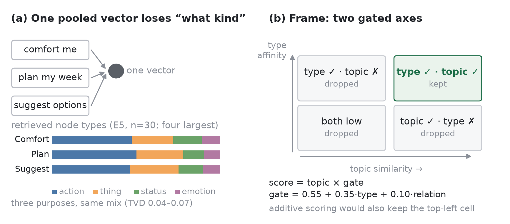
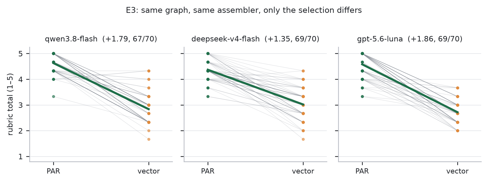
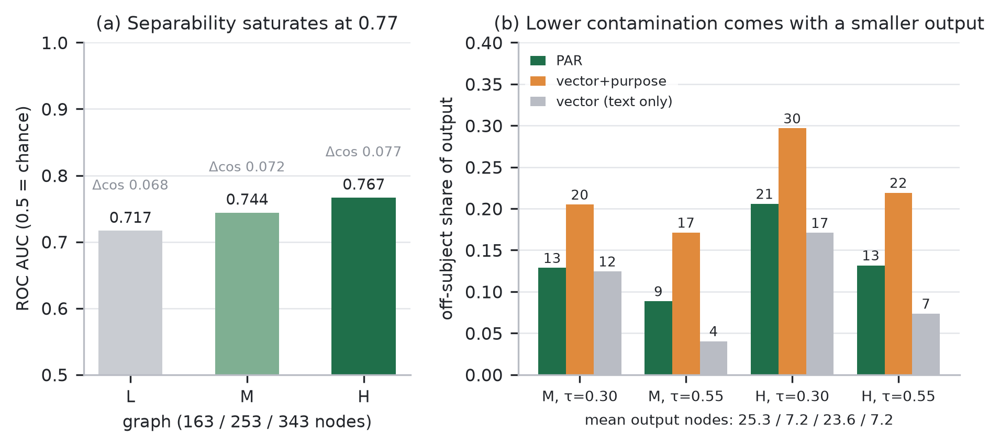

# PAR：目的驱动的联想记忆检索

> 面向开发者的原理与实现说明：它是什么、为什么这样设计、现在能做到什么、边界在哪。
> 论文 v0.5（全部实验、统计口径与失败案例）：[PAR-paper-zh.md](../paper/PAR-paper-zh.md) /
> [PAR-preprint-v0.5.pdf](../paper/PAR-preprint-v0.5.pdf)。
> 图构建与维护见 0828 companion report：[前置数据管理与后处理](0828前置数据管理与后处理.md)。
> 本页版本：2026-11-19。
>
> 代码位置：`dba_pipeline/retrieval/retriever.py`（主链路）、`core/jump_axis.py`（边权重）、
> `core/purpose.py`（目的向量）、`core/purpose_frame.py`（结构化的目的）、`core/peak_find.py`（寻峰）。

---

## 0. 五分钟速览

**它做什么**：给定一句用户消息，从一张记忆图里取出一小段"理解此刻用户"所需的记忆，
交给下游模型。不是找"和这句话最像的文档"，而是找"按当前目的应该想起的几段"。

**和 RAG 的差别**：

| | RAG | PAR |
|---|---|---|
| 找什么 | 与 query 相似的文档 | 与当前目的相关、且彼此有关系的记忆 |
| 怎么找 | 向量 top-k | 向量起步 → 沿类型化关系扩展 → 按目的过滤 → 到峰值就停 |
| 输出 | 排序列表 | 集合（会再交给 StoryRank 写成一段） |
| 评价 | 命中率 | 这段上下文是否支撑"理解用户" |

**三个机制**：

1. **跳转轴**：不是每条边都走。按"从哪类节点出发、走哪类关系、正向还是反向"查表，
   权重为 0 表示禁止。
2. **目的**：先判断"这是不是这件事"，再在候选里分"要哪一类内容"。两者**相乘**，
   类型对但不能补偿话题不对。
3. **峰值容忍带**：每轮算目的关联度均值，首次显著下降后按 patience 停止，只保留峰值附近几轮，
   而不是固定跳数或固定 top-k。当前默认（`first_peak=False`）会在 μ 回升时重置计时，
   因此多峰链会走得更深，详见第 4 节。

**现在能做到什么**（同一张图、同一个组装器下）：

- 只换选择机制：PAR 4.63 / 4.37 / 4.58，纯向量 2.84 / 3.02 / 2.72（三家 judge；
  存档 bandfix 批次，同批与稳健性见 6.2）。
- 目的写成三项要求后：类型分布差异 0.09 → 0.47，命中率 0.30 → 0.53；
  但 0.47 是**自然输出**下的数字，等条数下只有 0.29–0.36（见 3.3/6.3）。
- 同输入重跑：节点集合 Jaccard 0.764（嵌入有微小非确定性）。

**已知边界**（详见第 7 节）：

- 目的的三项要求目前靠人工对照表，5 句自由表述里 4 句认不出；
- 数据规模小（163 节点、76 条查询）、评价依赖 LLM judge，没有人工评估；
- 默认目的阈值 0.30 在 163 节点主图上不删任何候选，等价于不过滤；过滤真正工作要到
  0.45–0.55，且以输出规模换精度（见 3.3/6.4）；
- 峰值带默认实现会在多峰链上走得更深，与"首峰即停"的设计意图不一致。

---

## 1. 它解决的问题

RAG 的典型设定是：用户提问，系统找相关段落，拼接后回答。这个设定隐含两个假设：
存在一个相对稳定的"相关集合"；这个集合可以按相关性从高到低排序、用 top-k 截断。

对话记忆不满足这两条。用户说"这周真的挺累的"，系统需要的不是"疲劳的医学定义"，
而是：他最近连续加班、周五有交付、压力大时喜欢去咖啡馆、不喜欢被直接建议"早点睡"。
这些记忆之间不是"与这句话相似"，而是"与此刻的目的相关"。

更麻烦的是，**同一段记忆在不同意图下价值不同**。同一句"这周真的挺累的"：

- 想倾诉时，该想起情绪和原因；
- 想排期时，该想起下周的时间与待办；
- 想听建议时，该想起可选项和过去有效的做法。

所以 PAR 的输出是**集合**，不是列表；评价也换成"这段上下文是否支持理解用户"，
而不是"命中了多少条 golden"。

---

## 2. 图：六类节点、八类关系

### 2.1 节点

| 类型 | 说明 |
|---|---|
| STATUS | 用户/助手的当前状态（在做后端、项目很赶） |
| REASON | 状态或事件的原因（需求临时增加） |
| ACTION | 做过或计划做的事（加班到十一点、下周排期） |
| THING | 物品、地点、时间、作品等实体（下周、周三凌晨） |
| PERSON | 人物与关系（技术主管老马、同事小王） |
| EMOTION | 情绪与感受（疲惫、烦躁） |

### 2.2 关系与跳转轴

八类关系：CAUSAL（因果）、SCENARIO（场景归属）、SEQUENCE（先后）、PREFERENCE（偏好）、
SOCIAL（社交）、ATTRIBUTE（属性）、TEMPORAL（时间）、TAXONOMIC（分类）。

PAR 给"节点类型 × 关系类型 × 方向"各定一个权重（正向/反向，0 = 禁止扩展）：

| 出发点 | CAUSAL | SCENARIO | SEQUENCE | PREFERENCE | SOCIAL | ATTRIBUTE | TEMPORAL | TAXONOMIC |
|---|---|---|---|---|---|---|---|---|
| STATUS | 0.9/1.0 | 0.8/0.8 | 0.7/0.0 | 0.4/0.0 | 0.5/0.5 | 0.3/0.3 | 0.3/0.0 | 0.0/0.0 |
| REASON | 1.0/0.9 | 0.6/0.6 | 0.8/0.0 | 0.2/0.0 | 0.4/0.4 | 0.3/0.3 | 0.3/0.0 | 0.0/0.0 |
| ACTION | 0.9/0.7 | 0.8/0.8 | 0.9/0.6 | 0.5/0.0 | 0.6/0.6 | 0.4/0.4 | 0.5/0.0 | 0.0/0.3 |
| THING | 0.3/0.3 | 1.0/1.0 | 0.4/0.4 | 0.8/0.0 | 0.3/0.3 | 0.7/0.7 | 0.3/0.0 | 0.0/0.3 |
| PERSON | 0.5/0.5 | 0.6/0.6 | 0.5/0.5 | 0.8/0.0 | 1.0/1.0 | 0.7/0.7 | 0.4/0.0 | 0.0/0.0 |
| EMOTION | 0.9/1.0 | 0.8/0.8 | 0.6/0.0 | 0.5/0.0 | 0.5/0.5 | 0.4/0.4 | 0.3/0.0 | 0.0/0.0 |

三条设计原则：

- **方向取决于出发点**：从 STATUS 出发，该找"是什么导致的"（反向 CAUSAL=1.0），
  而不是往"上位概念"漂（TAXONOMIC=0）。
- **零权重是禁止，不是"很小"**：情绪类的问题不该沿分类链走到无关大类。
- **矩阵是手工先验**，没有做敏感性分析或数据驱动拟合。这是已知的局限，不是"已标定"。

---

## 3. 目的：决定"要哪一类"

### 3.1 老做法的问题

最早的做法是：让模型把目的写成几句话，拼起来转成一个向量，再找"和这个向量近"的记忆。

问题在于，这三句话说的往往是同一件事。同一句"这周真的挺累的"，三种目的分别是
"倾诉连续加班的疲惫""规划下周工作排期""推荐适合高强度工作的减压方式"——它们的话题
高度重合，向量也高度重合。检索于是只能看出"像不像"，看不出"要哪一类内容"。

实测（10 个情景 × 3 种目的）：三种意图召回的节点类型分布几乎一样，
总变差距离（TVD）只有 0.04–0.07；用户想倾诉时，召回里情绪节点只占 10.6%。



*图 1：(a) 三条目的被压成一个向量后，三种意图召回的节点类型分布几乎相同；
(b) 拆成三项要求后，只有"话题匹配且类型匹配"的候选保留。*

### 3.2 新做法：三项要求 × 乘性门控

把目的拆成三项：

1. **要哪一类内容**：状态 / 感受 / 做法 / 事物 / 人 / 原因（就是上面的节点类型）；
2. **沿哪一类关系找**：因果 / 先后 / 同类 / 属性等（就是上面的关系类型）；
3. **说的是哪一段事**：用用户原话去锚定。

检索时三者合成一个目的分：

> 分数 = 话题相似 × 门控
> 门控 = 0.55 + 0.35 × 类型亲和 + 0.10 × 关系亲和

关键是**相乘**。先判断"是不是这件事"，过了这一关才按类型排序。如果改成相加，
类型分没有上界，能把话题不对的记忆顶上来——同一个情景上，命中率会从 0.58 掉到 0.23；
改成相乘后回到 0.60。

类型亲和不是二值：目标类型的亲和度为 1，其余类型保留 0.25 的下限。因为情绪的成因
常常是一条 action（"每天加班到十一点"），硬砍会连带砍掉证据。

### 3.3 现在到哪一步

给定三项要求后（`purpose_frame`），同一批 30 条上：

| 目的阈值 | 类型分布差异（逐情景） | 类型分布差异（汇总） | 命中率 | 平均输出条数 |
|:---:|:---:|:---:|:---:|:---:|
| 0.30 | 0.240 → 0.256 | 0.137 → 0.166 | 0.277 → 0.330 | 9.5 → 10.0 |
| 0.40 | 0.246 → **0.422** | 0.119 → **0.372** | 0.289 → **0.512** | 9.5 → 9.0 |
| 0.45 | 0.272 → **0.524** | 0.090 → **0.473** | 0.301 → **0.529** | 9.5 → 7.6 |
| 0.50 | 0.245 → **0.486** | 0.094 → **0.440** | 0.456 → 0.460 | 8.7 → 6.1 |

每格是"原写法 → 新写法"。注意三点：

- **0.47 是自然输出下的 TVD**：τ=0.45 时输出从 9.5 降到 7.6，**等条数下 TVD 只有 0.29–0.36**。
  也就是说，TVD 的自然提升一部分来自输出变小；过滤本身的选择贡献要用等规模口径看
  （同等条数下 gold recall 高 24–29pp、跨主体混入低 4–7pp，代价是 gold 被删 4–6%）。
- **阈值必须重标**：门控把分数整体压低了，旧阈值 0.30 下过滤几乎不触发（通过率 0.91；
  在主图上不删任何节点），0.45 才真正开始工作（通过率 0.30）。换表示就要重标阈值。
- **"推荐"仍然弱**：图里"助手做了对比"和"助手随口建议"属于同一类节点，类型上分不开。

三项要求目前由一张人工对照表给出（看到"倾诉"就给感受优先），5 句自由表述里 4 句认不出：
"我想被听见""帮我劝劝我妈""确认上次体检的结果"都会退回原方法。**表示形式已验证，
从表述到表示的这一步还没解决。**

### 3.4 代码

```python
from dba_pipeline.core.purpose_frame import compile_frame

purposes = ["倾诉连续加班的疲惫", "表达对临时需求的不满"]
retriever.purpose_filter_threshold = 0.45        # 换目的表示后必须重标
result = retriever.retrieve(
    "这周真的挺累的。",
    purpose=purposes,
    purpose_frame=compile_frame(purposes),        # None = 旧行为（只用目的向量）
)
```

`purpose_frame=None` 时行为与改造前完全一致；`frame_weights=(0.55, 0.35, 0.10)` 可调
嵌入/类型/关系的配比；`frame_anchor=0.4` 会把话题相似度往用户原话拉，实测在这张图上
影响很小（TVD 0.473 → 0.440），默认关闭。

---

## 4. 峰值容忍带：什么时候停

PAR 不用固定跳数，也不固定 top-k，而是每轮算目的关联度均值：

> μ_h = 本轮通过过滤的候选的目的分的平均值

找到峰值轮 h*，把 μ_h ≥ μ_h* − δ 的轮次（默认 δ = 0.10）全部收下，
去重后输出；种子轮（第 0 轮）无条件保留，且不参与寻峰。

不用组合得分寻峰，是因为组合分里带了 `decay^hop` 的确定性衰减，
用它算斜率会在第 1 跳造出"伪峰值"。

**已知偏差**：设计意图是"遇到第一个峰就停"——多条因果链会交叉、闭环，
抓完整条链必然重复，覆盖缺口由其他种子的首峰补。但当前默认实现（`first_peak=False`）
会在 μ 回升时重置计时，因而在多峰链上走得更深。受控实验里，改成首峰即停可减少 19%
的输出，命中仅降 0.8pp。这里报告的数字基于现行实现，没有切换默认值。

---

## 5. 一次检索走完

1. **定目的**：调用方注入，或由 `InferenceEngine.infer_purpose` 从 query 推断；
2. **选种子**：一半来自 query 向量，一半来自目的向量（有 `purpose_frame` 时按帧重排）；
3. **逐跳扩展**：沿跳转轴取邻居，按目的分过滤，算组合分（跳转权重 × 距离衰减 + 目的分）；
4. **寻峰**：每轮记 μ，判断是否到峰；
5. **收集**：种子轮 ∪ 峰值容忍带内的各轮候选，按分数截断；
6. **故事化**（可选）：`retrieve_with_story` 把节点与边交给 StoryRank，写成一段。

输出结构：

```python
{
  "peak_memories": [(id, content), ...],
  "peak_scores": {id: combined_score},
  "purpose": {"status": ..., "purposes": [...]},
  "hop_history": [{"hop", "candidates", "mean_score"}, ...],
  "peak_band": {...}, "purpose_pass": [...],   # 观测读数，便于调参
}
```

---

## 6. 实测结果

评测数据是情感陪伴场景的一张 163 节点 / 237 边人工图、76 条查询；judge 为三家模型，
温度 0，逐题匿名打乱。以下只摘关键结论，完整表格与统计口径见
[PAR 论文 v0.5](../paper/PAR-paper-zh.md)。

### 6.1 系统级

| Judge | Ariadne（本仓库链路） | Graphiti | Mem0 |
|---|:---:|:---:|:---:|
| qwen3.8-flash | **4.71** | 3.70 | 2.92 |
| deepseek-v4-flash | **4.56** | 3.25 | 3.40 |
| gpt-5.6-luna | **4.46** | 3.77 | 3.46 |

这只能说明"完整流程更有用"，不能归因到 PAR 的某个机制——三个系统的抽取、存储、
组装都不同。另外，Ariadne 为当前链路重跑，Graphiti/Mem0 取自存档；E1 的领先幅度
只作方向性证据。

### 6.2 同图隔离：只换选择方式

同一张图、同一句话、同一个组装器，只换"怎么选记忆"：

| Judge | PAR | 纯向量 top-k | 差值 | 提升题数 |
|---|:---:|:---:|:---:|:---:|
| qwen | **4.63** | 2.84 | +1.79 | 67/70 |
| deepseek | **4.37** | 3.02 | +1.35 | 69/70 |
| gpt | **4.58** | 2.72 | +1.86 | 69/70 |

三个 judge 的 rank-biserial r ≈ 1.00，是最稳的一条结论。

表是**存档 bandfix 批次**；同批重跑（deepseek）C−D 为 1.633，删 30% 边 / 随机重连 /
DBA 自动图 / 换 bge-large-zh-v1.5 下为 1.163–1.596，方向与量级保持。
不要把存档 1.296 与同批 1.633 混比；两者差 0.34，超过 0.2 的噪声带。



*图 2：每条细线是一条查询（n=70），粗线为均值；三格为三个 judge。*

### 6.3 目的表示的失败与修正

- 旧写法：三种意图的类型分布 TVD 0.04–0.07，倾诉召回中情绪节点仅 10.6%；
- 关掉目的通道：节点集合 Jaccard 仅 0.31（说明机制确实在改变结果），
  但去掉后 gold 命中反而更高（0.894 vs 0.857）——改变的方向对错各半。
  注意：默认 τ=0.30 在主图上不删任何节点，所以这里测的是**目的种子/加权**，不是过滤。
- 新写法（三项要求）：TVD 0.09 → 0.47，命中率 0.30 → 0.53，但依赖人工对照表。
  0.47 是自然输出；等条数下 TVD 只有 0.29–0.36，TVD 的一部分提升来自输出变小，
  过滤本身的贡献要用等规模口径看（见 3.3）。

### 6.4 阈值能救多少：天花板

把两个完全不同主体的记忆叠进同一张图（163 / 253 / 343 节点），
用 ROC AUC 衡量"同主体 vs 跨主体"的可分性：



*图 3：(a) 可分性（0.5 = 随机）；(b) 跨主体混入率与输出规模。*

三档 AUC 为 0.717 / 0.744 / 0.767，节点 bootstrap 95% CI 全重叠（L [0.689, 0.767]、
M [0.724, 0.786]、H [0.753, 0.805]）——**加两个完全无关的人，可分性没有显著提升**。
pAUC（FPR ≤ 0.10）为 3.74 / 5.00 / 5.55 倍随机，说明高分段确实更可分；但 TPR@FPR=10%
只有 0.33–0.43，局部工作点仍以丢正例为代价。由于 AUC 是排序指标，任何单调阈值变换都
突破不了它。τ=0.30 在主图上不删任何节点；τ=0.55 才真正咬合，跨主体混入从 20.6% 降到
13.2%，但输出条数从 23.6 掉到 7.2——是拿召回换精度。分位阈值同一 p 下混入率跨图极差
3.5–3.9pp，可对齐混入率，但不能对齐输出预算。

### 6.5 稳定性与失败形态

- 同输入重跑三次：节点集合 Jaccard 0.764，叙事文本相似度 0.837。
  因此这里的比较只在差值 ≥ 0.2 时下结论。
- 76 条产物的失败编码：跨域内容陪跑 92.1%，叙事补推断 56.6%，未覆盖诉求 25.0%，
  整体跑偏仅 2.6%。**主要问题不是搜错方向，而是搜得太杂。**
  注意：92.1% 是**严格服务标准**下的比例；同一探针改判"用户建模"标准为 0%（n=27），
  但该标准近乎同义反复，只能说明数字依赖标准，不能反证叙事有用。引用时必须带限定。

---

## 7. 已知边界

1. **数据小**：163 节点、76 条查询、人工构造，结论限定在情感陪伴场景。
   人工图/自动图、结构扰动与换 embedding 下机制排序保持（C−D 1.16–1.63，r ≥ 0.96），
   但仍是单场景、单图族。
2. **分化度不足**：同场景与跨场景余弦大量重叠（AUC 0.717–0.767，三档 CI 重叠），
   默认 τ=0.30 在主图上不删任何节点，等价于不过滤；τ=0.55 才进入局部工作点，
   但以输出规模换混入（零和）。
3. **LLM judge**：一致性 α 0.657 / 0.774 是 **judge 之间**的信度，不等于人类判断；
   未做人工评估（E6-lite 已搁置）。
4. **目的编译未解**：三项要求靠人工对照表，5 句自由表述 4 句认不出；
   "推荐"这一类在类型维上不可分。
5. **峰值带与设计意图有偏差**：默认多峰链会走更深，未切到首峰即停。
6. **跳转轴矩阵是手工先验**：48 格权重没有敏感性分析，也没有从数据学习。
7. **单次生成有抖动**：重跑 Jaccard 0.764，小于 0.2 的差值不作结论。
8. **评测可复现性**：检索/存储实现与 `eval/` 脚本开源；部分实验数据、judge 产物与
   API 凭证不在开源仓库，复现需自备环境。

---

## 8. 参数一览

| 参数 | 默认 | 作用 |
|---|:---:|---|
| `seed_k` | 5 | 种子数量 |
| `max_hops` | 5 | 最大扩展跳数 |
| `expand_k` | =seed_k | 每轮进入下一跳的候选数 |
| `distance_decay` | 0.85 | 每跳的确定性衰减 |
| `jump_weight_coef` | 0.5 | 组合分里跳转权的比重 |
| `purpose_weight_coef` | 0.5 | 组合分里目的分的比重 |
| `purpose_filter_threshold` | 0.30 | 逐跳目的过滤阈值（随嵌入模型重标；主图上 0.30 为空操作，有效工作点 0.45–0.55） |
| `peak_tolerance` | 0.10 | 峰值带宽 δ |
| `purpose_frame` | None | 结构化的目的；None = 只用目的向量 |
| `frame_weights` | (0.55, 0.35, 0.10) | 嵌入 / 类型 / 关系的配比 |
| `frame_anchor` | 0.0 | 把话题相似度往用户原话拉（0 = 关闭） |

---

## 9. 术语表

| 词 | 含义 |
|---|---|
| 种子轮（hop 0） | 由 query / 目的向量直接找出的起始节点，无条件进入输出 |
| 跳转轴 | "节点类型 × 关系类型 × 方向"的扩展权重表 |
| 目的分 | 候选与当前目的的相关度；有 `purpose_frame` 时是乘法门控的结果 |
| 峰值容忍带 | 峰值附近 δ 以内的各轮候选的并集 |
| TVD | 两个分布的总变差距离；0 = 一样，1 = 完全不相交 |
| gold facet | 某个意图下"应当被想起"的节点组，用于算命中率 |
| StoryRank | 把节点与边整理成一段叙事的组装器 |

---

## 10. 更新记录（2026-11-19）

- 明确默认 τ=0.30 在 163 节点主图上为空操作；有效过滤工作点在 0.45–0.55，且零和。
- 补 E11 的等规模口径：TVD 0.47 是自然输出，等条数下为 0.29–0.36；TVD 提升部分来自输出变小。
- 补 E14 的 AUC 置信区间（三档重叠）、E13 的 pAUC 与分位阈值结论。
- 补 E12a/E12b/E15c 的稳健性：C−D 1.16–1.63，r ≥ 0.96。
- 补 E9 的严格标准限定：92.1% 不是绝对失败率；用户建模标准下为 0%，但该标准过宽。
- 标注 E6-lite 已搁置；论文 v0.5 与 0828 companion report 的链接已更新。
